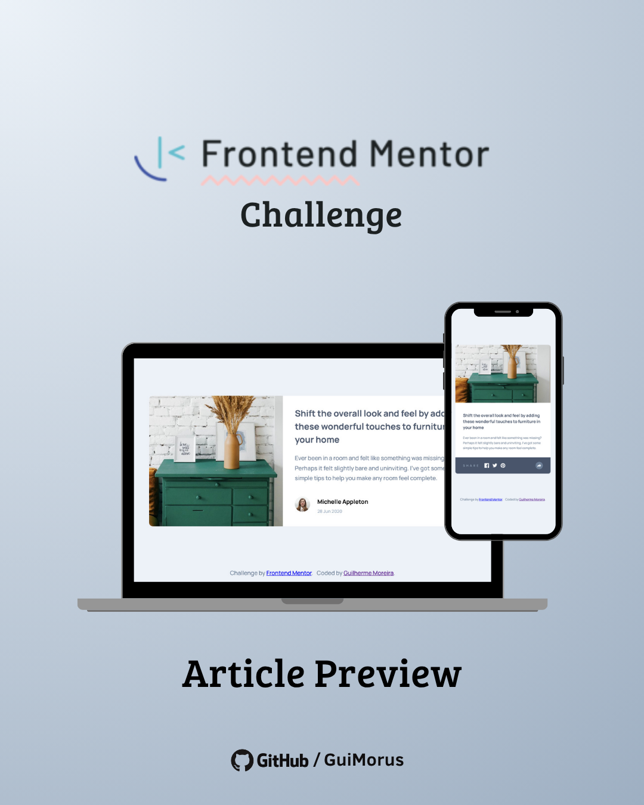

# 📰 Article Preview Component

This project is a responsive article preview component developed as part of a **Frontend Mentor** coding challenge.

The challenge provided the design references and project requirements, and my goal was to bring the static design to life using **HTML, CSS, and JavaScript**, focusing on responsive layout, semantic structure, styling, and user interaction.

## 📷 Media

## 🚀 Technologies & Techniques

- HTML5
- CSS3
- JavaScript
- Semantic HTML
- CSS Flexbox
- CSS Grid
- Responsive Design
- Media Queries
- DOM Manipulation
- Event Listeners
- Data Attributes
- CSS Transitions
- Dynamic UI interaction

## 💡 Comments

This project was developed from scratch based on the designs and requirements provided by **Frontend Mentor**.

The main goal was to reproduce the provided desktop and mobile layouts as accurately as possible while keeping the implementation simple and organized.

JavaScript was used to handle the share button interaction, displaying and hiding the social media sharing options according to the user's interaction.

Although this is a relatively small project, it was useful for practicing the fundamentals of front-end development, especially responsive layouts, semantic HTML, CSS positioning, and DOM manipulation.

## 📚 Learnings

During this project, I practiced:

- **HTML5:** structuring the content using semantic elements and accessible markup.

- **CSS3:** styling the component and reproducing the visual characteristics of the provided design.

- **Flexbox:** creating flexible layouts and aligning elements within the component.

- **CSS Grid:** organizing elements when necessary within the layout.

- **Responsive Design:** adapting the component to different screen sizes based on the provided mobile and desktop designs.

- **Media Queries:** creating different layout behaviors depending on the viewport width.

- **DOM Manipulation:** selecting and modifying HTML elements through JavaScript.

- **Event Listeners:** handling user interactions with the share button.

- **Data Attributes:** using HTML `data-*` attributes to associate information with elements.

- **CSS Transitions:** creating smoother visual transitions when interface elements change.

- **Semantic HTML:** choosing appropriate HTML elements to improve the structure and meaning of the page.

## 🔗 Project

- **Deploy:** [Article Preview Component](https://guimorus.github.io/challenge-article/)

## 🎖 Credits

This project was built by **Guilherme Moreira** as part of my studies in Front-end development.

The project is based on the **[Article Preview Component](https://www.frontendmentor.io/challenges/article-preview-component-dYBN_pYFT)** challenge provided by **Frontend Mentor**.

The design references, requirements, and initial assets were provided by Frontend Mentor. The implementation, HTML structure, CSS styling, responsiveness, and JavaScript interactions were developed by me.

This project was created for educational purposes, with the goal of practicing fundamental front-end development concepts and transforming a static design into a functional and responsive web interface.
